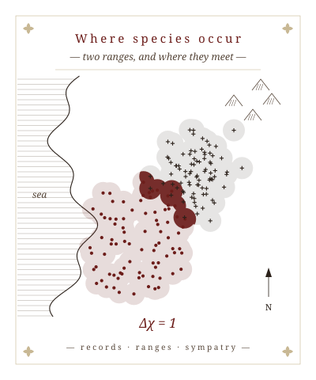
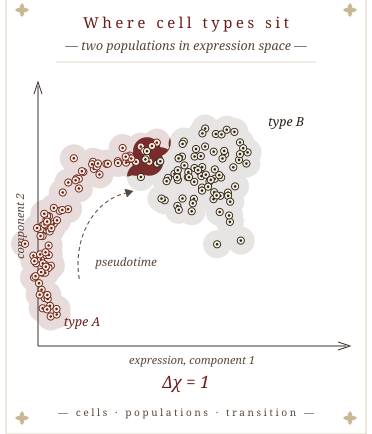
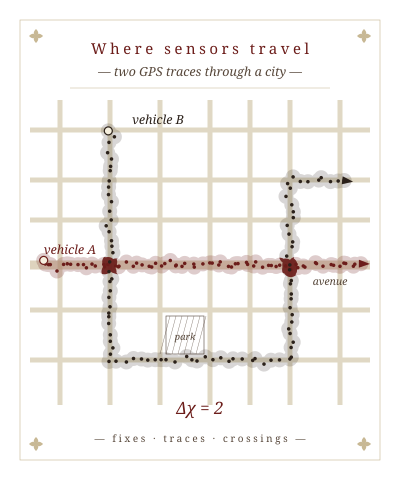
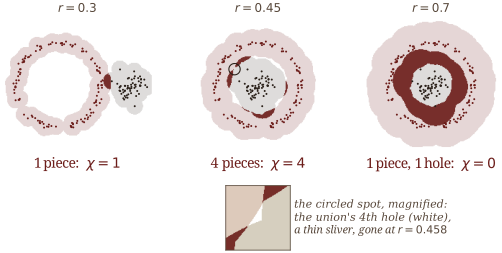
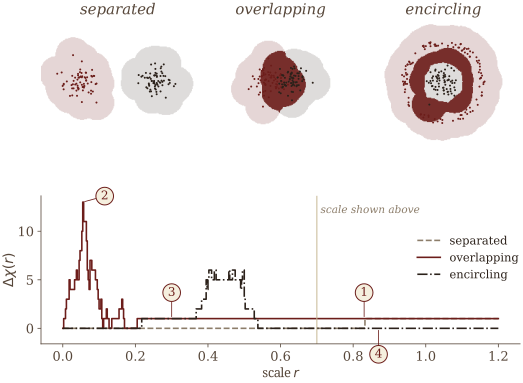
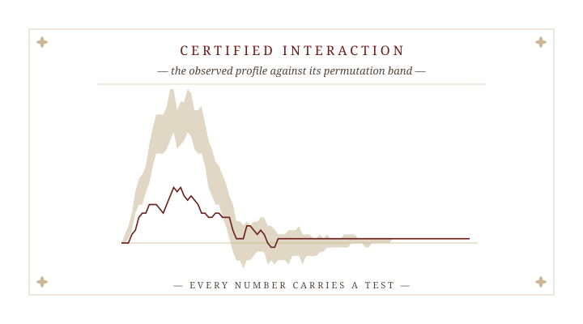
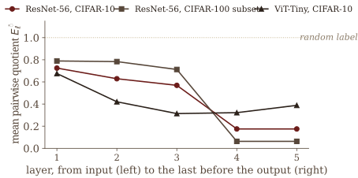
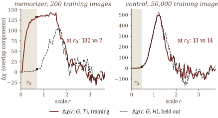
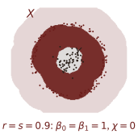
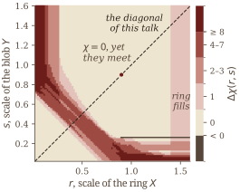

## Several clouds, one space

::: {.plate-row}
::: {.plate data-plate="A"}

:::

::: {.plate .fragment data-plate="B"}

:::

::: {.plate .fragment data-plate="C"}

:::
:::

::: {.aside-note}
In each plate: points, their ball unions, and in dark red the overlap; $\Delta\chi$ is its Euler characteristic at the drawn scale.
:::

::: {.notes}
⏱ 1:00 (title included) · by 1:00

[MDS26, after Bei Wang: Bei's descriptors summarize one space at a time. I want to ask what happens when there are several.]

Thank you. The data I have in mind is several point clouds in one space. Where two species are recorded: each record a point, each range a union of balls, and where the ranges overlap, the species meet.

[click] Cells of two types, placed in an expression space: where the populations overlap, cells of one type sit among the other.

[click] Two vehicles' GPS traces through a city: one along the avenue, one through the side streets; where their routes cross. In each plate the dark region is the overlap, and the number under it is its Euler characteristic at that scale: one zone, one zone, two crossings.
:::


## How much do they interact?

::: {.source}
image barcode: chromatic alpha complexes, Cultrera di Montesano et al., [arXiv:2212.03128](https://arxiv.org/abs/2212.03128)
:::

::: {.opener-quote}
How much do several point clouds interact **topologically**, and **at what scale**?
:::

:::: {.chain-stack}
::: {.chain .fragment .fade-out data-fragment-index="3"}

:::

::: {.chain .fragment .fade-in-then-out data-fragment-index="3"}

:::

::: {.chain .fragment .fade-in data-fragment-index="4"}

:::
::::

:::: {.chain-stack}
::: {.chain .aside-note .fragment .fade-out data-fragment-index="3"}
**Far apart.** Inside $X\cup Y$, $X$'s features are unchanged: $Y$ does not touch its topology. The overlap is empty until the balls meet.
:::

::: {.chain .aside-note .fragment .fade-in-then-out data-fragment-index="3"}
**Touching.** Still unchanged. The overlap is a lens: $\Delta\chi=1$.
:::

::: {.chain .aside-note .fragment .fade-in data-fragment-index="4"}
**Inside the hole.** Inside $X\cup Y$, $X$'s loop dies at $0.55$, not $1.40$: $Y$ fills it. The **overlap** is the meeting.
:::
::::

```{=html}
<span class="fragment anim-step" data-fragment-index="1" data-frame="1" data-r="0.7"></span>
<span class="fragment anim-step" data-fragment-index="2" data-frame="1" data-r="1.2"></span>
<span class="fragment anim-step" data-fragment-index="3" data-frame="2" data-r="0.3"></span>
<span class="fragment anim-step" data-fragment-index="4" data-frame="3" data-r="0.45"></span>
<span class="fragment anim-step" data-fragment-index="5" data-frame="3" data-r="0.7"></span>
<span class="fragment anim-step" data-fragment-index="6" data-frame="3" data-r="1.5"></span>
```

::: {.notes}
⏱ 1:35 · by 2:35

So: how much do several clouds interact topologically, and at what scale? A ring X, a blob Y, and a ball of radius r on every point; I grow r by hand. Top right: X's features as they survive inside the union, the image of H of X in H of X union Y. Below: the Euler characteristic of the overlap.

[click] Far apart, at 0.7: X's loop is untouched, the overlap empty.

[click] At 1.2 the balls meet in a lens; the profile steps to one. X still does not see Y.

[click] Touching, at 0.3: a lens again.

[click] Inside the hole, at 0.45: a handful of small pieces.

[click] At 0.7 Y has filled X's loop: in the union it died at 0.55, not 1.40. The overlap is an annulus: they plainly meet, yet its Euler characteristic is zero. Hold on to that.

[click] At 1.5, one blob. The image says Y changed X, not where they meet. The overlap is the meeting, and its Euler characteristic, scale by scale, is the object of this talk.
:::


## Why not a barcode?

::: {.source}
[arXiv:2608.06180](https://arxiv.org/abs/2608.06180)
:::

::: {.methods .hard-table}
| | in barcodes of interaction | in the profile |
|:--|:--|:--|
| **what is measured** | one cloud's diagram is blind to the other; the union's mixes each cloud's own topology with their meeting | the overlap itself |
| **symmetry** | the image $H(X)\to H(X\cup Y)$ privileges one cloud | symmetric in the clouds |
| **more than two clouds** | no canonical image for $k>2$ | the $k$-fold overlap |
| **vectorization** | a diagram must be vectorized for a test or a learner: lossy, non-canonical | an integer curve, used as is |
| **inference** | no hypothesis test | exact permutation tests |
| **two scales** | two-parameter persistence has no barcode, no complete discrete invariant | an integer surface $\Delta\chi(r,s)$ |
| **cost** | a matrix reduction, cubic in the simplex count | a signed count over sorted simplices |
:::

::: {.rmk .fragment data-name="The price"}
One integer per scale: graded homology is lost, and $\chi$ is blind on annuli. Hence the guard of § III, and the paper's relative refinement.
:::

::: {.notes}
⏱ 0:55 · by 3:30

Why not just use that barcode? Several of these gaps are recorded as open by the barcode's own authors. A single cloud's diagram is blind to the other, and the union's mixes each cloud's topology with their meeting. The image privileges one cloud and has no canonical form for three. A diagram must be vectorized before a test or a learner can use it, which is lossy and non-canonical. There is no test. With two scales, two-parameter persistence has no barcode at all. And image persistence needs a matrix reduction. The profile answers each row with one integer per scale.

[click] The price: graded homology, and the annulus. We will meet both again.
:::


# § I.  Euler Calculus {.section-divider}

::: {.plate data-plate="I"}

:::

::: {.notes}
⏱ 0:10 · by 3:40

Section one: the definition, three examples, and why this curve and not another.
:::


## The profile

::: {.source}
[arXiv:2608.06180](https://arxiv.org/abs/2608.06180)
:::

::: {.definition data-num="1" data-name="Intersection ECP"}
For disjoint finite clouds $\mathcal X=(X_1,\dots,X_k)$ in $\mathbb R^d$ and scales $\mathbf t=(t_1,\dots,t_k)\in\mathbb R^k_{\ge0}$, the Euler characteristic of the overlap of the ball unions $\mathcal U(X_i;t_i)=\bigcup_{p\in X_i}B(p,t_i)$:
$$
\Delta\chi(\mathbf t;\mathcal X)\;=\;\chi\Big(\bigcap_{i=1}^k\mathcal U(X_i;t_i)\Big),\qquad\text{in the plane: pieces minus holes.}
$$
:::

::: {.fig-wide style="width: 58%; margin: -0.2rem auto 0;"}

:::

::: {.theorem .fragment data-num="1" data-name="Intersection theorem" data-cite="Kawamura–Majhi–Mitra"}
An Euler integral, $\Delta\chi=\int\prod_{i}\mathbf 1_{\mathcal U(X_i;t_i)}\,d\chi$; for two clouds on the diagonal $\mathbf t=(r,r)$, $\Delta\chi(r)=\chi_X(r)+\chi_Y(r)-\chi_{X\cup Y}(r)$.
:::

::: {.notes}
⏱ 1:15 · by 4:55

The definition, in one line: the profile is the Euler characteristic of the overlap of the ball unions, scale by scale. Each cloud may have its own scale; everything in this talk is on the diagonal, all scales equal, and we will see the whole surface at the end. In the plane that is the number of pieces minus the number of holes. Three overlaps from the opening: a lens, one piece, chi one; four small pieces, four; the annulus, one piece and one hole, zero.

[click] Two facts make it useful. It is an Euler integral, of the product of the clouds' indicators against the Euler characteristic; in two slides we will see that nothing about integrals needs to be assumed. And for two clouds on the diagonal, inclusion and exclusion write it with three ordinary Euler characteristic curves: of X, of Y, and of the pooled cloud. Hold on to that formula; it is the whole algorithm.
:::


## Reading a profile

::: {.source}
[arXiv:2608.06180](https://arxiv.org/abs/2608.06180)
:::

::: {.fig-row}
::: {.fig style="flex-basis: 58%;"}

:::

::: {.stmts}
::: {.rmk .fragment data-name="1 · First contact"}
The curve leaves zero at $r^\ast$, half the gap between the clouds.
:::

::: {.rmk .fragment data-name="2 · The burst"}
At small scales, many tiny lenses where single points meet: the sample, not the shape.
:::

::: {.rmk .fragment data-name="3 · The plateau"}
A value held across scales is the answer; Theorem 5 makes it precise.
:::

::: {.rmk .fragment data-name="4 · A zero after contact"}
The clouds meet, yet $\chi$ of an annulus is $0$: the blind spot, checked by the guard of § III.
:::
:::
:::

::: {.notes}
⏱ 1:15 · by 6:10

Before the theory, how to read a profile. Three configurations, and their profiles over every scale.

[click] One: first contact. The separated pair is zero until the unions touch, at half the gap between the clouds; call that scale r star.

[click] Two: the burst at small scales. Where the clouds interpenetrate, single points meet in many tiny lenses. That is the sample, not the shape.

[click] Three: the plateau. Past the burst, the overlapping pair settles at one and stays there. A value that holds across scales is the answer; the consistency theorem will make that precise.

[click] Four: a zero after contact. The encircling pair meets, but the overlap is an annulus, and its Euler characteristic is zero. The blind spot; the test in section three carries a guard for exactly this.
:::


## Why not the overlap's homology?

::: {.source}
[arXiv:2608.06180](https://arxiv.org/abs/2608.06180)
:::

::: {.env-row}
::: {.proposition data-num="1" data-name="Mayer–Vietoris" data-cite="Kawamura–Majhi–Mitra"}
For $A=\mathcal U(X;t)$, $B=\mathcal U(Y;s)$ and $\Delta\beta_q=\beta_q(A)+\beta_q(B)-\beta_q(A\cup B)$,
$$
\beta_q(A\cap B)=\Delta\beta_q+\delta_q+\delta_{q+1},
$$
with $\delta_q$ the rank of the connecting map $H_q(A\cup B)\to H_{q-1}(A\cap B)$. The alternating sum cancels the $\delta$'s:
$$
\chi(A\cap B)=\chi(A)+\chi(B)-\chi(A\cup B).
$$
:::

::: {.proposition .fragment data-num="2" data-name="The overlap's own complex" data-cite="Kawamura–Majhi–Mitra"}
The nerve of the cross-cloud lenses $B(x,t)\cap B(y,s)$ computes the overlap. It has up to $mn$ vertices, and $\ell$ lenses with a common point span $2^\ell-1$ faces, with $\ell$ as large as $mn.$
:::
:::

::: {.rmk .fragment data-name="So: the Euler characteristic"}
$\Delta\chi$ is the Euler characteristic curve of the overlap filtration, the alternating sum of its Betti curves, read off the Alpha complexes of the clouds and of their union, never the overlap's: cheap enough for $999$ permutations per test.
:::

::: {.notes}
⏱ 1:15 · by 7:25

The question this room will ask: why the Euler characteristic, and not the persistent homology of the overlap?

Because homology does not split over a union. Mayer–Vietoris gives the overlap's Betti numbers as the clouds' inclusion–exclusion plus the ranks of the connecting maps, and those ranks need the homology of the overlap itself. In the alternating sum they cancel.

[click] And a complex for the overlap is expensive: the nerve of the lenses can have two to the m n faces.

[click] So the profile is the Euler characteristic curve of the overlap filtration, read off the Alpha complexes of the clouds and their union, never the overlap's. That is what makes it cheap: a permutation test recomputes it a thousand times.
:::


## Why this curve

::: {.source}
[arXiv:2608.06180](https://arxiv.org/abs/2608.06180)
:::

:::: {.vbody}
::: {.theorem data-num="2" data-name="Universality" data-cite="Kawamura–Majhi–Mitra"}
[Let $I(A_1,\dots,A_k)=\Phi(\mathcal X)(\mathbf t)$ for $A_i=\mathcal U(X_i;t_i)$, defined on finite unions of finite intersections of balls, be]{.hyp}

- **a valuation in each cloud:** inclusion–exclusion when one cloud's union is split, the others fixed;
- **homotopy invariant:** it depends only on the homotopy type of $\bigcap_i A_i$;
- **separating:** $0$ when $\bigcap_i A_i=\emptyset$;
- **normalized:** $1$ when $\bigcap_i A_i$ is nonempty and contractible.

Then $I(A_1,\dots,A_k)=\chi\big(\bigcap_i A_i\big)$, that is, $\Phi=\Delta\chi$. Neither $\chi$ nor an integral is assumed.
:::

::: {.rmk .fragment data-name="What it says, and what it does not"}
It picks **which** summary of the overlap; it does not say that its value measures strength: $\chi$ is signed and not monotone. Strength is for the tests.
:::
::::

::: {.notes}
⏱ 0:40 · by 8:05 · can be cut: say "four natural axioms force the Euler characteristic of the overlap" and move on.

Why this curve, and not another? Ask four things of any interaction number: that it respond to each cloud by inclusion and exclusion, that it see only the topology of the overlap, that it read zero when the clouds do not meet, and one when the overlap is contractible. Nothing about Euler characteristics is assumed. The only such number is the Euler characteristic of the overlap: the profile.

[click] It picks the summary; it does not say a bigger value means more interaction, since chi is signed. Whether clouds interact is for the tests.

(The valuation axiom, in symbols: I(..., A union A', ...) + I(..., A intersect A', ...) = I(..., A, ...) + I(..., A', ...), the other arguments fixed.)

(If asked: a weaker form assumes an Euler integral of the indicators, and then separation and normalization on a single lens already force the profile.)
:::


# § II.  Computation and Stability {.section-divider}

::: {.plate data-plate="II"}

:::

::: {.notes}
⏱ 0:10 · by 8:15

Section two: what it costs, and how it moves when the data move.
:::


## Computation

::: {.source}
[arXiv:2608.06180](https://arxiv.org/abs/2608.06180)
:::

::: {.theorem data-num="3" data-name="Complexity" data-cite="Kawamura–Majhi–Mitra"}
For $|X|+|Y|=n$ in fixed dimension $d$, sweeping the Alpha complexes of $X$, $Y$ and $X\cup Y$ in birth order computes $\Delta\chi$ in $O\big(n^{\lceil d/2\rceil}\log n\big)$ time and $O\big(n^{\lceil d/2\rceil}\big)$ space, forming no boundary matrix.
:::

::: {.fig-row}
::: {.fig .fragment data-fragment-index="1" style="flex-basis: 57%;"}

:::

::: {.stmts}
::: {.rmk .fragment data-fragment-index="1" data-name="The sweep"}
Each Euler characteristic curve is a running sum $\sum_{a(\sigma)\le r}(-1)^{\dim\sigma}$ over simplices sorted by birth. Measured: $3.7$ s per pair, against $31.7$ s for the mixup barcode on the same clouds ([arXiv:2609.08561](https://arxiv.org/abs/2609.08561)).
:::

::: {.rmk .fragment data-fragment-index="2" data-name="Optimal, and beyond two"}
In even $d$ the exponent is optimal for any algorithm that builds the filtration. $k$ clouds by inclusion–exclusion, $O\big(2^k n^{\lceil d/2\rceil}\log n\big)$; off the diagonal, a weighted Alpha complex.
:::
:::
:::

::: {.notes}
⏱ 1:30 · by 9:45

The cost. Three Alpha complexes: of X, of Y, and of the pooled cloud. Sort each by birth scale, and its Euler characteristic curve is a running sum of signs. No boundary matrix, no reduction.

[click] Here are the ring and the blob from the opening. The strip is the sweep for the pooled cloud: every edge a minus one at its birth, every triangle a plus one. Above, the solid curve is the Euler characteristic of X plus that of Y, and the dashed one is that of the union. Both start at a hundred and eighty, one per point, and fall together. The gap between them is the profile, below: first the loops in the gap between the clouds, then the ring filling in. In practice, on trained networks' class clouds: under four seconds per pair, against half a minute for the mixup barcode on the same clouds.

[click] In even dimension the exponent cannot be lowered by any algorithm that builds the filtration. For k clouds, inclusion and exclusion over the subsets; off the diagonal, with a different scale per cloud, a weighted Alpha complex does the same job.
:::


## Stability

::: {.source}
[arXiv:2608.06180](https://arxiv.org/abs/2608.06180)
:::

::: {.theorem data-num="4" data-name="Stability" data-cite="Kawamura–Majhi–Mitra"}
[Let $\epsilon=\max_i d_H(X_i,X_i')$. Then]{.hyp}

- the overlap filtrations of $\mathcal X$ and $\mathcal X'$ are $\epsilon$-interleaved;
- $\Delta\chi(r)=\Delta\chi'(r)$ **exactly**, whenever $[r-\epsilon,r+\epsilon]$ holds no critical scale of either;
- $\|\Delta\chi-\Delta\chi'\|_{L^1}\le2\epsilon\,(N+N')$, with $N,N'$ the numbers of bars of the two overlap barcodes, all degrees.
:::

::: {.fig-wide .fragment style="margin: 0 auto;"}
{style="width: 560px;"}
:::

::: {.rmk .fragment data-name="The honest form"}
$\Delta\chi$ itself admits no interleaving distance, and no $L^1$ bound free of the bar count can hold.
:::

::: {.notes}
⏱ 1:30 · by 11:15

Stability, stated as it is proved. Move every point by at most epsilon. The overlap filtrations are epsilon-interleaved, so their persistence modules are; the profile is exactly equal away from the critical scales; and its L1 distance is at most twice epsilon times the total number of bars.

[click] In the picture: two crossing rings, and the same rings with every point moved. The curves coincide except in the shaded strips, near the scales where something happens. The long plateau at two is the two lenses where the rings cross. This is the plateau reading made rigorous: plateaus survive a perturbation; only the steps can move.

[click] And the honest form: the profile itself carries no interleaving distance, and the bar count in the L1 bound cannot be removed. Integer-valued means that close becomes equal, away from the critical scales.
:::


## Consistency

::: {.source}
[arXiv:2608.06180](https://arxiv.org/abs/2608.06180)
:::

:::: {.vbody}
::: {.theorem data-num="5" data-name="Consistency" data-cite="Kawamura–Majhi–Mitra"}
[Let $A_1,\dots,A_k\subset\mathbb R^d$ be compact with reach at least $\tau>0$, sampled i.i.d. from measures supported on them and positive on balls; let $\rho\mapsto T_\rho=\bigcap_i\mathcal U(A_i;\rho)$ have finitely many critical values in $(0,\tau)$, and $r\in(0,\tau)$ be regular for it. Then almost surely, for all large samples:]{.hyp}

- **persistently:** with $\epsilon_{\max}=\max_i d_H(X_i,A_i)\to0$, the $\epsilon_{\max}$-persistent Euler characteristic of the sample overlap is $\chi(T_r)$;
- **exactly:** $\Delta\chi(r;X_1,\dots,X_k)=\chi(T_r)$ when $r$ is also regular for the sample.
:::

::: {.rmk .fragment data-name="How many samples"}
$O\big(\epsilon^{-k_i}(\log\tfrac1\epsilon+\log\tfrac1\delta)\big)$ points from $A_i$ for confidence $1-\delta$, with $\epsilon$ set by the distance from $r$ to the critical scales: the **intrinsic** dimension $k_i$, not the ambient $d$.
:::
::::

::: {.notes}
⏱ 0:20 · by 11:35 · can be cut: keep the first sentence only.

Consistency: for samples of sets of positive reach, the profile recovers the population overlap's Euler characteristic at regular scales, exactly when the scale is regular for the sample too. The plateau you read on a sample is the population's answer.

[click] The sample size depends on the intrinsic dimension, not the ambient one.
:::


# § III.  Certified Interaction {.section-divider}

::: {.plate data-plate="III"}

:::

::: {.notes}
⏱ 0:10 · by 11:45

Section three: every number carries a test, and three applications.
:::


## Every number carries a test

::: {.source}
[arXiv:2609.08561](https://arxiv.org/abs/2609.08561)
:::

::: {.env-row}
::: {.definition data-num="2" data-name="Interaction quotient"}
With $\Phi(\Delta\chi)=\int|\Delta\chi(r)|\,dr$,
$$
\widehat E=\frac{\Phi\big(\Delta\chi(\cdot;X_1,\dots,X_k)\big)}{\mathbb E_{H_0}\,\Phi}\,,
$$
about $1$ when the labels are exchangeable, tending to $0$ under separation.
:::

::: {.proposition .fragment data-fragment-index="0" data-num="3" data-name="Exact tests" data-cite="Majhi"}
[If the labels of the pooled sample are exchangeable,]{.hyp} the two one-sided permutation $p$-values satisfy $\Pr[p\le\alpha]\le\alpha$ for every statistic, every $\alpha$, every sample size and every number $B$ of permutations.
:::
:::

::: {.fig-row}
::: {.fig .fragment data-fragment-index="1" style="flex-basis: 57%;"}

:::

::: {.stmts}
::: {.rmk .fragment data-fragment-index="2" data-name="A guard for the blind spot"}
Readings 1 and 4 together: a separation claim is withheld when $\Delta\chi$ is silent just beyond first contact $\hat r^\ast$, where the unions provably meet. Unguarded, the test certifies an annular overlap as separated, with probability tending to one.
:::
:::
:::

::: {.notes}
⏱ 1:45 · by 13:30

The inferential layer. The interaction quotient is the profile's mass divided by its mean under relabeling: about one when the labels are exchangeable, near zero when the clouds are separated.

[click] To test: pool the points, relabel, recompute, compare. Both one-sided tests are exact: valid at every level, for every sample size and every number of permutations.

[click] Two overlapping blobs. The band is what relabeling produces; the observed profile lies below it at almost every scale. On the right, the mass under 999 relabelings, and the observed mass far to its left: a quotient of 0.38, and p of one in a thousand, the smallest p that 999 relabelings can give. Certified: less interaction than relabeling produces. Not that the clouds are disjoint; the quotient, 0.38, says how much is left.

[click] The guard is readings one and four together: after first contact, a profile that stays at zero. On the encircling example the profile vanishes, so the separation test would reject, with probability tending to one, exactly where the clouds meet. The repair costs nothing: the first interaction scale falls out of the same sweep, and if the profile is silent just beyond it, where the unions provably meet, we withhold the separation claim.
:::


## Monsoon onset

::: {.source}
[arXiv:2604.15262](https://arxiv.org/abs/2604.15262)
:::

::: {.standfirst .math}
A four-signal onset detector: the profile between the delay-embedded windows before and after each day, with complexity variance, Higuchi fractal dimension and a rolling mean. Delete the profile, or swap it for a null channel that sees no data, and test the paired change $\Delta$ in mean error, in days.
:::

::: {.methods .fragment .monsoon-table}
| onset | system | $\Delta$, deleted | $p$ | $\Delta$, vs. null | $p$ |
|:--|:--|:-:|:-:|:-:|:-:|
| moderate | Nepal | $-0.10$ | 0.905 | $+1.94$ | 0.028 |
| sharp | Kerala | $-0.84$ | 0.200 | $+0.11$ | 0.887 |
| gradual | Western North Pacific | $\mathbf{-3.03}$ | **0.003** | $-1.02$ | 0.246 |
| gradual | Australian | $\mathbf{-3.66}$ | **< 0.001** | $-1.00$ | 0.204 |
:::

::: {.aside-note .fragment}
About one day is the topology's, and it is not significant. The firmer evidence: the multi-delay profile is the best unsupervised onset detector on both gradual targets. With Atish Mitra, Santanu Nandi, Md Nurujjaman and Buddha Nath Sharma.
:::

::: {.notes}
⏱ 1:30 · by 15:00

An application where the honest answer is smaller than the first one, which is why every number carries a test. Monsoon onset from a daily monsoon index, with four signals; one is the profile between the windows before and after each day. To see what the topology contributes, delete it and test the paired change in error.

[click] On the Indian targets, nothing survives the test. Where onset is gradual and noisy, the Western North Pacific and the Australian, deleting it costs three days or more, significantly. Our first version stopped there. But the other three channels share a late bias, and any fourth channel dilutes it. So we swapped the profile for a channel that sees no data: that recovers two thirds of the gain, and the day left for the topology is not significant.

[click] What survives is narrower: the multi-delay profile is the best unsupervised onset detector on both gradual targets, ahead of the standard baselines. Joint work with Atish, Santanu Nandi, Md Nurujjaman and Buddha Nath Sharma.
:::


## Disentanglement, certified

::: {.source}
[arXiv:2609.08561](https://arxiv.org/abs/2609.08561)
:::

::: {.standfirst .math}
Class-conditional clouds of $111$ trained networks: $1{,}170$ (network, layer, checkpoint) cells, $52{,}650$ pairwise measurements, each with an exact test.
:::

::: {.fig-row}
::: {.fig style="flex-basis: 56%;"}

:::

::: {.stmts}
::: {.rmk .fragment data-name="Depth-graded"}
The mean pairwise quotient falls with depth: $0.72\to0.63\to0.57\to0.18$ on ResNet-56, CIFAR-10.
:::

::: {.rmk .fragment data-name="Early, step by step"}
$12{,}375$ paired sign-flip tests between consecutive checkpoints, on a **scale-free** statistic: $2{,}707$ significant steps, $2{,}026$ of them decreases, $1{,}728$ within the first $8$ epochs.
:::
:::
:::

::: {.notes}
⏱ 1:30 · by 16:30

Second application: when does a classifier pull its classes apart? Take the class-conditional point clouds at each layer and checkpoint of 111 trained networks. Every pairwise number carries an exact test. The dotted line at one is what relabeling gives; everything below it is disentanglement.

[click] Disentanglement is graded by depth: the quotient falls stage by stage, and the deep stage is far from the null. The ViT turns at block 6 of 8 and re-entangles toward its head.

[click] Over training, paired sign-flip tests between consecutive checkpoints, corrected for multiple testing: two thousand seven hundred significant steps, three quarters of them decreases, most in the first eight epochs. One lesson from building the test: the statistic must be scale-free. The raw mass has units of length, so the training dynamics of the feature norm masquerade as disentanglement; on it, every first-epoch step points the wrong way.

(If asked whether a nearest-neighbour count shows the same: for ranking class pairs, yes, Spearman 0.86 against the quotient's 0.83, and the paper says so. What the profile adds is the certificate, the k-fold terms and the scale. Backup slide: *Simpler statistics*.)
:::


## Mostly pairwise

::: {.source}
[arXiv:2609.08561](https://arxiv.org/abs/2609.08561)
:::

::: {.definition data-num="3" data-name="Triple versus strongest pair"}
For classes $c,c',c''$ at layer $\ell$: $\ \rho_\ell=\widehat E_\ell(c,c',c'')\,\big/\,\max\big\{\widehat E_\ell(c,c'),\widehat E_\ell(c,c''),\widehat E_\ell(c',c'')\big\}$. Only a $k$-fold profile can pose it.
:::

::: {.fig-wide .fragment style="width: 76%; margin: 0.1rem auto 0;"}

:::

::: {.aside-note .fragment}
$\rho\le1$ in $1{,}509$ of $1{,}560$ triple–layer cells ($96.7\%$), median $0.63$. An unstructured null already reaches $83\%$; the evidence is the medians, $0.44$–$0.89$ against $0.85$–$1.03$ ($p=3.3\times10^{-8}$). The pairwise matrix carries almost all the class-overlap structure the profile can see: a regularity, not a law.
:::

::: {.notes}
⏱ 1:00 · by 17:30 · can be cut: give the 96.7% and the median 0.63, skip the null comparison.

A question only a k-fold statistic can ask: is a triple of classes more entangled than its most entangled pair?

[click] Every triple, at every layer of the three architectures: the triple's quotient over its strongest pair's.

[click] At or below one in ninety-seven percent of the cells, median 0.63. Careful: an unstructured null already scores eighty-three. The evidence is the medians, against the null's: p of three in a hundred million. So the pairwise matrix carries almost all the class-overlap structure the profile can see. A regularity, not a law: an adversarial search finds ratios near two.
:::


## Memorization, counted

::: {.source}
[arXiv:2610.00251](https://arxiv.org/abs/2610.00251)
:::

::: {.standfirst .math}
Does a generator copy its training images? Compare its samples' overlap with training images $T$ and held-out images $H$; if it copies nothing, relabelling $T$ and $H$ is an exact null, for a random held-out split.
:::

::: {.definition data-num="4" data-name="Small-scale mass"}
$T_{\rm small}=\int_0^{r_0}|\Delta\chi(r;G,T)|\,dr-\int_0^{r_0}|\Delta\chi(r;G,H)|\,dr$ below the near-duplicate scale $r_0$, where excess overlap components estimate the distinct images copied.
:::

::: {.fig-row}
::: {.fig .fragment data-fragment-index="1" style="flex-basis: 57%;"}

:::

::: {.stmts}
::: {.rmk .fragment data-fragment-index="1" data-name="Copies, counted"}
CIFAR-10 diffusion models at $r_0$: $132$ against $7$ on a $200$-image memorizer, $13$ against $14$ on the control. With Pramita Bagchi.
:::

::: {.rmk .fragment data-fragment-index="2" data-name="What the scale buys"}
Of $24$ generators that copy nothing, a nearest-neighbour statistic rejects $7$, $T_{\rm small}$ one; a count at $r_0$ is as specific. The profile adds steadiness in $r_0$ and a $3$-fold form.
:::
:::
:::

::: {.notes}
⏱ 1:15 · by 18:45 · can be cut: one sentence, "the same profile counts the training images a generative model copies, with an exact null".

A third application, with Pramita Bagchi. Does a generative model copy its training images? Take its samples, the training images, and images held out. If the model copies nothing, and the held-out images were split off at random, training and held-out images are exchangeable given the samples, so relabelling them is an exact test. The statistic is the profile's mass below the near-duplicate scale, against training minus against held-out.

[click] At that scale, shaded, a diffusion model trained on 200 images has 132 overlap components with its training set and 7 with held-out images; each excess component is, roughly, a distinct image copied. The control, trained on fifty thousand, has 13 against 14.

[click] Honestly, the scale buys the specificity, not the topology: a plain count at that scale is as specific. The profile adds steadiness in the choice of scale, and a three-fold form that asks which images two models both copy: the k-fold form again, now across models.
:::


## What remains

::: {.source}
[arXiv:2608.06180](https://arxiv.org/abs/2608.06180)
:::

::: {.env-row .remains-row}
::: {.qcol}
::: {.question data-num="1" data-name="Whether, not how much"}
$\chi$ is signed and blind on annuli. The paper's relative-homology refinement sees them and is stable; can a test use it directly?
:::

{.remains-fig}
:::

::: {.qcol .fragment}
::: {.question data-num="2" data-name="Off the diagonal"}
A different scale per cloud: what does the two-parameter profile $\Delta\chi(r,s)$ certify that the diagonal cannot?
:::

{.remains-fig}
:::
:::

::: {.rmk .fragment data-name="Next, with Kazuhiro Kawamura and Atish Mitra"}
*Statistical Inference for Topological Interaction* · *Reconstruction of Transversal Intersections from Separate Samples*
:::

::: {.notes}
⏱ 0:50 · by 19:35; Thank-you slide to about 19:50, leaving 5 minutes for questions.

What remains. The opening picture once more: the ring and the blob plainly meet, but the overlap is an annulus, and its Euler characteristic is zero. The relative refinement sees it and is stable; can a test use it?

[click] Off the diagonal, each cloud at its own scale: the whole surface for the same clouds. This talk lived on the dashed line, and most of the surface is that blind zero. What does the surface certify that the line cannot? [MDS26: Robyn is about to tell us how to read two-parameter objects like this one.]

[click] Two pieces of work in progress, both with Kazuhiro and Atish: the statistics of topological interaction, and reconstructing a transversal intersection from separate samples.

Thank you.
:::


## Thank you {.colophon}

```{=html}
<div class="finis">Q . E . D .</div>
```

::: {.contact}
[arXiv:2608.06180](https://arxiv.org/abs/2608.06180) · [arXiv:2609.08561](https://arxiv.org/abs/2609.08561) · [arXiv:2604.15262](https://arxiv.org/abs/2604.15262) · [arXiv:2610.00251](https://arxiv.org/abs/2610.00251) · [smajhi.com](https://smajhi.com) · [s.majhi@gwu.edu](mailto:s.majhi@gwu.edu)
:::

::: {.subscription}
*Joint work with* Kazuhiro Kawamura and Atish Mitra. SIAM Conference on Mathematics of Data Science · Salt Lake City · 16 November 2026.
:::


## Mixup barcodes {visibility="uncounted"}

::: {.source}
[arXiv:2608.06180](https://arxiv.org/abs/2608.06180)
:::

::: {.rmk data-name="Neither refines the other"}
The mixup barcode of Wagner et al. is the image persistence of $\mathcal U(Y;r)\hookrightarrow\mathcal U(X\cup Y;r)$. It keeps graded homology that $\Delta\chi$ collapses, yet it does not determine $\Delta\chi$, which needs $\chi$ of one cloud alone. The comparison is by properties.
:::

::: {.methods}
| | mixup barcode | $\Delta\chi$ |
|:--|:-:|:-:|
| symmetric in the clouds | no | yes |
| $k>2$ clouds | open | inclusion–exclusion |
| hypothesis test | open | exact permutation tests |
| cost | image persistence, cubic in the simplex count | sweep, $O(n^{\lceil d/2\rceil}\log n)$ |
| measured, identical clouds | $31.7$ s per pair | $3.7$ s per pair |
:::

::: {.aside-note}
Timing on the final-epoch representations of $104$ networks ([arXiv:2609.08561](https://arxiv.org/abs/2609.08561)). In fairness: there, total mixup predicts generalization better than the null-normalized quotient, $R^2=0.84$ against $0.34$.
:::

::: {.notes}
Backup. The barcode keeps graded homology we throw away, and neither invariant determines the other. What we gain is symmetry, every k, an exact integer readout, and no matrix reduction: about eight and a half times faster per pair on the same clouds, which is what makes a thousand permutations per test affordable. In fairness, total mixup predicted generalization better than our quotient, because the quotient divides out the feature scale on purpose.
:::


## The relative refinement {visibility="uncounted"}

::: {.source}
[arXiv:2608.06180](https://arxiv.org/abs/2608.06180)
:::

::: {.definition data-num="A" data-name="Relative interaction module"}
What each cloud adds to the others:
$$
\mathrm{RPH}_*(\mathcal X)=\bigoplus_{i=1}^{k}\Big\{H_*\big(\mathcal U(X_i;t_i),\ \mathcal U(X_i;t_i)\cap\textstyle\bigcup_{j\ne i}\mathcal U(X_j;t_j)\big)\Big\}_{\mathbf t\ge0}.
$$
:::

::: {.theorem data-num="A" data-name="Stability" data-cite="Kawamura–Majhi–Mitra"}
[For color-matched perturbations, $\epsilon=\max_i d_H(X_i,X_i')$,]{.hyp} $d_I\big(\mathrm{RPH}_*(\mathcal X),\mathrm{RPH}_*(\mathcal X')\big)\le\epsilon$ in the multiparameter interleaving distance.
:::

::: {.rmk data-name="What it sees, and what it does not"}
Sample $Y$ on a torus and $X$ on a longitude: the overlap is a band and every $\chi$ vanishes, yet $H_1(T^2,S^1)=H_2(T^2,S^1)=\mathbb Z$. For $k\ge3$ it is not complete, and it needs persistence rather than a sweep.
:::

::: {.notes}
Backup. Keep the inclusions, not just chi: for each cloud, its homology relative to its overlap with the others, summed over the clouds. It is interleaving-stable under color-matched perturbation. It sees the torus-and-longitude example that chi misses; for three or more clouds it is provably incomplete, and it costs a persistence computation. We do not yet test with it, which is open question one.
:::


## High dimensions {visibility="uncounted"}

::: {.source}
[arXiv:2609.08561](https://arxiv.org/abs/2609.08561)
:::

::: {.proposition data-num="A" data-name="Projection is conservative for separation" data-cite="Majhi"}
[For an orthogonal projection $P$ and $r^\ast(X,Y)=\tfrac12\min_{x\in X,y\in Y}\|x-y\|$,]{.hyp} $r^\ast(PX,PY)\le r^\ast(X,Y)$: offsets disjoint in the shadow are disjoint in the ambient space.
:::

::: {.env-row}
::: {.rmk data-name="What we do"}
Measure on a PCA shadow fitted to the pooled clouds, blind to labels, so the tests stay exact: $d_0=5$, or $4$ for triple scans. Depth conclusions are unchanged at $d_0=3,4,6$: median Spearman $0.91$, $0.96$, $0.97$ against $d_0=5$.
:::

::: {.rmk data-name="Where it breaks"}
Concentration of measure. In embeddings of high effective rank the scale window collapses: on copy-detection features (effective rank $574$) the topological statistics go null while a nearest-neighbour fraction still fires ([arXiv:2610.00251](https://arxiv.org/abs/2610.00251)).
:::
:::

::: {.notes}
Backup. We measure on a five-dimensional PCA shadow fitted without labels, so exactness survives. Projection can only bring first contact earlier, so disjointness in the shadow is disjointness in the ambient space. The depth conclusions do not move between three and six dimensions. The real limit is concentration of measure: in high effective rank the scale window collapses, and there a nearest-neighbour statistic still works where ours goes null.
:::


## The guard in practice {visibility="uncounted"}

::: {.source}
[arXiv:2609.08561](https://arxiv.org/abs/2609.08561)
:::

::: {.rmk data-name="On trained networks: never"}
Zero firings in $52{,}650$ pairwise measurements ($42{,}570$ distinct clouds), and zero again when $45{,}225$ cells were re-evaluated under three forms of the guard. Class overlaps are blobs: $\Delta\chi$ first returns to zero a median $78$ of $181$ grid points after contact. Zero says the pattern never occurred, not that cancellation is impossible.
:::

::: {.rmk data-name="Where it matters"}
$X$ uniform on a disc, $Y$ on a circle inside it: the overlap is an annular band, and the unguarded test certifies separation at $p_\downarrow=0.005$. The first interaction scale, $\hat r^\ast=0.005<0.40$, blocks it, at no cost: it falls out of the same sweep.
:::

::: {.notes}
Backup. Never, on trained networks: zero firings in fifty-two thousand measurements, and zero again under stricter forms of the guard, because class overlaps are blobs, not annuli. It still matters: on a disc with a circle inside, the unguarded test certifies separation at p of half a percent, and the guard blocks it for free. The synthetic case is from the statistics paper in preparation.
:::


## Simpler statistics {visibility="uncounted"}

::: {.source}
[arXiv:2609.08561](https://arxiv.org/abs/2609.08561) · [arXiv:2610.00251](https://arxiv.org/abs/2610.00251) · [arXiv:2604.15262](https://arxiv.org/abs/2604.15262)
:::

::: {.methods}
| question | simpler statistic | the profile |
|:--|:-:|:-:|
| rank MNIST pairs by confusability (Spearman) | $5$-NN $0.86$, probe $0.83$, energy $0.77$, Fisher $0.74$ | quotient $0.83$ |
| memorization: of $24$ generators that copy nothing, rejected | nearest-neighbour $7$, count at $r_0$ $0$ | $T_{\rm small}$ $1$ |
| memorization: copies needed to be seen, of $500$ | nearest-neighbour $50$ | $T_{\rm small}$ $10$, as the count |
| monsoon onset against persistence diagrams | — | ahead by $8.2$ days (WNP), $11.6$ (Australian) |
:::

::: {.aside-note}
Often a simpler statistic does as well, and the papers say so. What the profile adds is the exact certificate, the $k$-fold terms and the scale resolution. MMD has not been benchmarked.
:::

::: {.notes}
Backup. Honestly, a five-nearest-neighbour count ranks MNIST confusability as well as we do, and in the memorization audit a thresholded count at the same scale is as specific. The profile earns its place with exact certificates, the k-fold and scale-resolved forms, and steadiness in the scale. Against persistence diagrams on the monsoon it wins on the two gradual-onset systems, though persistence is faster there. We have not benchmarked MMD.
:::
