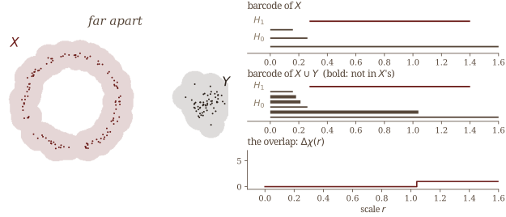
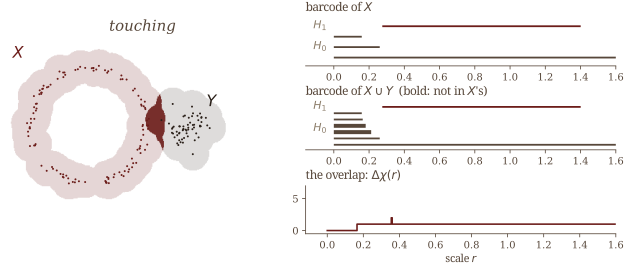
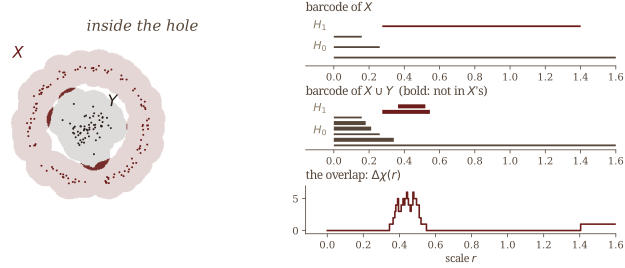
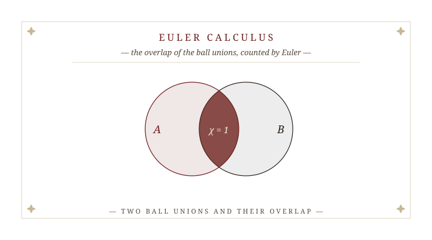
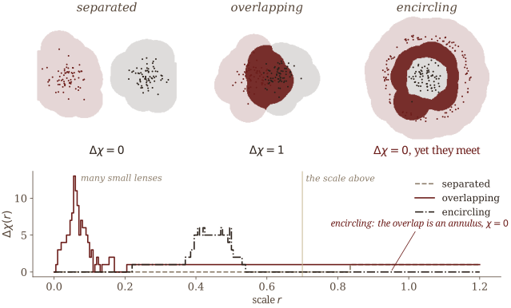
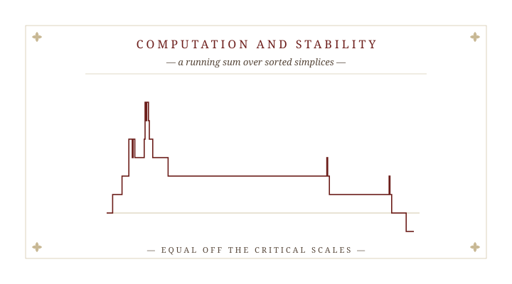
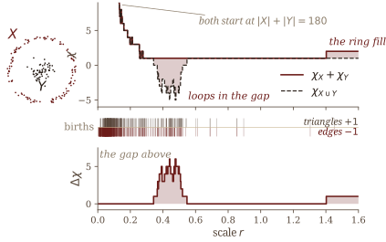
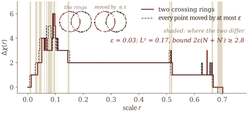
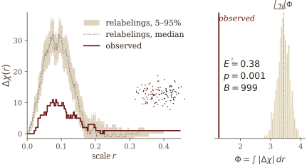
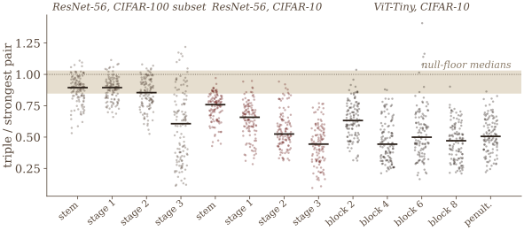

## How much do they interact?

::: {.opener-quote}
How much do several point clouds interact **topologically**, and **at what scale**?
:::

:::: {.chain-stack}
::: {.chain .fragment .fade-out data-fragment-index="2"}
{.approach-fig}
:::

::: {.chain .fragment .fade-in-then-out data-fragment-index="2"}
{.approach-fig}
:::

::: {.chain .fragment .fade-in data-fragment-index="3"}
{.approach-fig}
:::
::::

:::: {.chain-stack}
::: {.chain .aside-note .fragment .fade-out data-fragment-index="2"}
**Far apart.** $X$'s barcode ignores $Y$; that of $X\cup Y$ gains a bar dying at half their distance. The overlap stays empty until the balls meet.
:::

::: {.chain .aside-note .fragment .fade-in-then-out data-fragment-index="2"}
**Touching.** The overlap is a lens: $\Delta\chi=1$.
:::

::: {.chain .aside-note .fragment .fade-in data-fragment-index="3"}
**Inside the hole.** $X\cup Y$'s barcode changes $X$'s own loop (it dies at $0.55$, not $1.40$) and gains the gap's. The **overlap** is the meeting.
:::
::::

::: {.notes}
⏱ 2:00 (title included) · by 2:20

[MDS26, after Bei Wang: Bei's descriptors summarize one space at a time. I want to ask what happens when there are several.]

Thank you. The question is simple to state. We have several point clouds in the same space: where species occur, where cell types sit in an expression space, the tracks of sensors. How much do they interact topologically, and at what scale?

Here is a ring X and a blob Y. As Y moves I show three readouts: the barcode of X alone, the barcode of the union, and at the bottom the Euler characteristic of the overlap of the two ball unions, as a function of the scale r.

Far apart: the barcode of X does not know Y exists. The union's barcode gains one bar, a component that dies at half their distance. The overlap stays empty until the balls meet, just past one.

[click] Touching: the overlap is a lens, and the bottom curve steps up to one at the scale where they meet.

[click] Inside the hole: look at the union's barcode. X's own loop now dies at 0.55 instead of 1.40, because Y fills the hole, and a new loop appears, the gap between them. The union's barcode mixes the topology of each cloud with their meeting. The overlap is the meeting itself, and its Euler characteristic, scale by scale, is the object of this talk.
:::


# § I.  Euler Calculus {.section-divider}

::: {.plate data-plate="I"}

:::

::: {.notes}
⏱ 0:10 · by 2:30

Section one: the definition, three examples, and why this curve and not another.
:::


## The profile

::: {.env-row}
::: {.definition data-num="1" data-name="Intersection ECP"}
For pairwise disjoint finite clouds $\mathcal X=(X_1,\dots,X_k)$ in $\mathbb R^d$, with $\mathcal U(X;t)=\bigcup_{p\in X}B(p,t)$, and scales $\mathbf t\in\mathbb R^k_{\ge0}$,
$$
\Delta\chi(\mathbf t;\mathcal X)\;=\;\int_{\mathbb R^d}\prod_{i=1}^k \mathbf 1_{\mathcal U(X_i;t_i)}\,d\chi .
$$
:::

::: {.theorem .fragment data-num="1" data-name="Intersection theorem" data-cite="Kawamura–Majhi–Mitra"}
$$
\Delta\chi(\mathbf t;\mathcal X)\;=\;\chi\Big(\bigcap_{i=1}^k\mathcal U(X_i;t_i)\Big).
$$
On the diagonal, for two clouds,
$$
\Delta\chi(r)=\chi_X(r)+\chi_Y(r)-\chi_{X\cup Y}(r).
$$
:::
:::

::: {.aside-note .fragment}
An integer-valued curve, not a diagram: it enters a test or a learning pipeline as it is, with no vectorization.
:::

::: {.notes}
⏱ 1:15 · by 3:45

The definition. Give each cloud its ball union at its own scale, multiply the indicator functions, and integrate against the Euler characteristic. That is Euler calculus. On the diagonal, one scale for all the clouds, it is a curve in r.

[click] The integral of a product of indicators is the Euler characteristic of the intersection, so the profile is simply the Euler characteristic of the overlap. For two clouds on the diagonal, inclusion and exclusion write it with three ordinary Euler characteristic curves: of X, of Y, and of the pooled cloud. Hold on to that formula; it is the whole algorithm.

[click] And it is an integer-valued curve, not a diagram: a test or a classifier takes it as it is, with nothing to vectorize.
:::


## Three configurations

::: {.example data-num="1" data-name="Separated, overlapping, encircling"}
At the marked scale the overlap is empty, a single region, and an annulus: $\Delta\chi=0,\ 1,\ 0$. The encircling clouds **meet**, yet $\chi$ of an annulus is $0$.
:::

::: {.fig-wide style="width: 69%; margin: 0.1rem auto 0;"}

:::

::: {.notes}
⏱ 1:15 · by 5:00

Three configurations, computed. On top, the two ball unions at one scale, with the overlap in dark red; below, the three profiles.

Separated: zero until the unions touch. Overlapping: at small scales a burst of tiny lenses, where single points of X and Y meet; then one overlap region, and the profile settles at one. Encircling: a ring around a blob. At the marked scale they clearly meet, but the overlap is an annulus, and the Euler characteristic of an annulus is zero.

That is the blind spot of any Euler-characteristic invariant, and I will not hide it: the test in section three carries a guard for exactly this case.
:::


## Why not persistence of the overlap?

::: {.env-row}
::: {.proposition data-num="1" data-name="Mayer–Vietoris" data-cite="Kawamura–Majhi–Mitra"}
For $A=\mathcal U(X;t)$, $B=\mathcal U(Y;s)$ and $\Delta\beta_q=\beta_q(A)+\beta_q(B)-\beta_q(A\cup B)$,
$$
\beta_q(A\cap B)=\Delta\beta_q+\delta_q+\delta_{q+1},
$$
with $\delta_q$ the rank of the connecting map $H_q(A\cup B)\to H_{q-1}(A\cap B)$. The alternating sum cancels the $\delta$'s:
$$
\chi(A\cap B)=\chi(A)+\chi(B)-\chi(A\cup B).
$$
:::

::: {.proposition .fragment data-num="2" data-name="The overlap's own complex" data-cite="Kawamura–Majhi–Mitra"}
The nerve of the cross-cloud lenses $B(x,t)\cap B(y,s)$ computes the overlap. It has up to $mn$ vertices, and $\ell$ lenses with a common point span $2^\ell-1$ faces, with $\ell$ as large as $mn.$
:::
:::

::: {.env-row}
::: {.rmk .fragment data-name="So: the Euler characteristic"}
$\Delta\chi$ is the Euler characteristic curve of the overlap filtration, the alternating sum of its Betti curves, read off the Alpha complexes of the clouds and of their union: cheap enough for $999$ permutations per test. The persistence of the overlap is stable too (Theorem 4), and the paper refines $\chi$ by a relative module.
:::

::: {.rmk .fragment data-name="What it gives up"}
On an annulus $\beta_0=\beta_1=1$ and $\chi=0$: the encircling clouds. Hence the guard of § III.
:::
:::

::: {.notes}
⏱ 1:45 · by 6:45

The question this room will ask: why the Euler characteristic, and not the persistent homology of the overlap?

Because homology does not split over a union. Mayer–Vietoris gives the Betti numbers of the overlap as the inclusion–exclusion of the clouds' Betti numbers, plus the ranks of the connecting maps, the deltas. To get those ranks from the sequence you need the homology of the overlap itself, with its inclusion maps. In the alternating sum the deltas cancel, and what is left is exactly the inclusion–exclusion of the clouds' own Euler characteristics.

[click] And a complex for the overlap is expensive. The nerve of the lenses has a vertex for every meeting pair, up to m times n, and all m times n lenses can share a point, so it can have two to the m n faces.

[click] So the profile is the Euler characteristic curve of the overlap filtration, the alternating sum of its Betti curves, read off the Alpha complexes of the clouds and of their union, never the overlap's. That matters for inference, because a permutation test recomputes it a thousand times. Nothing is thrown away: the persistence of the overlap is stable too, as the next section says, and the paper refines the Euler characteristic by a relative persistence module.

[click] What it gives up: an annulus has one component and one loop, so Euler characteristic zero. That is the encircling picture again, and the reason for the guard.
:::


## Why this curve

:::: {.vbody}
::: {.theorem data-num="2" data-name="Universality" data-cite="Kawamura–Majhi–Mitra"}
[Let $\Phi$ assign to each $\mathcal X$ an integer profile, with]{.hyp}

- **pointwise Euler form:** $\Phi(\mathcal X)(\mathbf t)=\int\varphi\big(\mathbf 1_{\mathcal U(X_1;t_1)},\dots,\mathbf 1_{\mathcal U(X_k;t_k)}\big)\,d\chi$ for some $\varphi:\mathbb Z^k\to\mathbb Z$, $\varphi(\mathbf 0)=0$;
- **separation:** $\Phi(\mathcal X)(\mathbf t)=0$ when the $k$-fold overlap is empty;
- **normalization:** $\Phi(\mathcal X)(\mathbf t)=1$ when the overlap is a single lens $\bigcap_i B(x_i,t_i)$.

Then $\Phi=\Delta\chi$.
:::

::: {.rmk .fragment data-name="What it says, and what it does not"}
It decides **which** Euler-level summary of the overlap, not that its value measures strength: $\chi$ is signed and not monotone. A stronger form asks only for a valuation in each cloud that depends on the overlap's homotopy type, with separation and normalization.
:::
::::

::: {.notes}
⏱ 1:00 · by 7:45 · can be cut: say "separation and normalization single out this curve among Euler integrals" and move on.

Why this curve, and not some other Euler integral? Suppose an assignment is an Euler integral of a pointwise function of the indicators; it registers nothing when the clouds have no common overlap; and it gives one on a single lens. Then it is the intersection profile. Separation and normalization force it.

[click] What this does not say is that a bigger value means a stronger interaction: the Euler characteristic is signed and not monotone. Universality picks the summary; deciding whether clouds interact is the job of the tests. The paper has a stronger version: a valuation in each cloud, depending only on the homotopy type of the overlap, with the same two axioms.
:::


# § II.  Computation and Stability {.section-divider}

::: {.plate data-plate="II"}

:::

::: {.notes}
⏱ 0:10 · by 7:55

Section two: what it costs, and how it moves when the data move.
:::


## Computation

::: {.theorem data-num="3" data-name="Complexity" data-cite="Kawamura–Majhi–Mitra"}
For $|X|+|Y|=n$ in fixed dimension $d$, sweeping the Alpha complexes of $X$, $Y$ and $X\cup Y$ in birth order computes $\Delta\chi$ in $O\big(n^{\lceil d/2\rceil}\log n\big)$ time and $O\big(n^{\lceil d/2\rceil}\big)$ space, forming no boundary matrix.
:::

::: {.fig-row}
::: {.fig .fragment data-fragment-index="1" style="flex-basis: 57%;"}

:::

::: {.stmts}
::: {.rmk .fragment data-fragment-index="1" data-name="The sweep"}
Each Euler characteristic curve is a running sum $\sum_{a(\sigma)\le r}(-1)^{\dim\sigma}$ over simplices sorted by birth. No persistence reduction.
:::

::: {.rmk .fragment data-fragment-index="2" data-name="Optimal, and beyond two"}
In even $d$ the exponent is optimal for any algorithm that builds the filtration. $k$ clouds by inclusion–exclusion, $O\big(2^k n^{\lceil d/2\rceil}\log n\big)$; off the diagonal, a weighted Alpha complex.
:::
:::
:::

::: {.notes}
⏱ 1:30 · by 9:25

The cost. Three Alpha complexes: of X, of Y, and of the pooled cloud. Sort each by birth scale, and its Euler characteristic curve is a running sum of signs. No boundary matrix, no reduction.

[click] Here are the ring and the blob from the opening. The strip is the sweep for the pooled cloud: every edge a minus one at its birth, every triangle a plus one. Above, the solid curve is the Euler characteristic of X plus that of Y, and the dashed one is that of the union. Both start at a hundred and eighty, one per point, and fall together. The gap between them is the profile, below: first the loops in the gap between the clouds, then the ring filling in. The cost is that of the Alpha complex, n to the ceiling of d over 2, times log n.

[click] In even dimension the exponent cannot be lowered by any algorithm that builds the filtration. For k clouds, inclusion and exclusion over the subsets; off the diagonal, with a different scale per cloud, a weighted Alpha complex does the same job.
:::


## Stability

::: {.theorem data-num="4" data-name="Stability" data-cite="Kawamura–Majhi–Mitra"}
[Let $\epsilon=\max_i d_H(X_i,X_i')$.]{.hyp} The overlap filtrations of $\mathcal X$ and $\mathcal X'$ are $\epsilon$-interleaved; $\Delta\chi(r)=\Delta\chi'(r)$ whenever $[r-\epsilon,r+\epsilon]$ holds no critical scale of either; and $\|\Delta\chi-\Delta\chi'\|_{L^1}\le2\epsilon\,(N+N')$, with $N,N'$ the numbers of bars.
:::

::: {.fig-wide .fragment style="width: 66%; margin: 0.15rem auto 0;"}

:::

::: {.rmk .fragment data-name="The honest form"}
$\Delta\chi$ itself admits no interleaving distance, and no $L^1$ bound free of the bar count can hold.
:::

::: {.notes}
⏱ 1:30 · by 10:55

Stability, stated as it is proved. Move every point by at most epsilon. The overlap filtrations are epsilon-interleaved, so their persistence modules are; the profile is exactly equal away from the critical scales; and its L1 distance is at most twice epsilon times the total number of bars.

[click] In the picture: two crossing rings, and the same rings with every point moved. The curves coincide except in the shaded strips, near the scales where something happens. The long plateau at two is the two lenses where the rings cross.

[click] And the honest form: the profile itself carries no interleaving distance, and the bar count in the L1 bound cannot be removed. Integer-valued means that close becomes equal, away from the critical scales.
:::


## Consistency

:::: {.vbody}
::: {.theorem data-num="5" data-name="Consistency" data-cite="Kawamura–Majhi–Mitra"}
[Let $A_1,\dots,A_k\subset\mathbb R^d$ be compact with reach at least $\tau>0$, sampled i.i.d. from measures supported on them and positive on balls; let $\rho\mapsto T_\rho=\bigcap_i\mathcal U(A_i;\rho)$ have finitely many critical values in $(0,\tau)$, and $r\in(0,\tau)$ be regular for it.]{.hyp} Then almost surely, for all large samples, the $\epsilon_{\max}$-persistent Euler characteristic of the sample overlap equals $\chi(T_r)$, where $\epsilon_{\max}=\max_i d_H(X_i,A_i)\to0$; and if $r$ is also regular for the sample, $\Delta\chi(r;X_1,\dots,X_k)=\chi(T_r)$ **exactly**.
:::

::: {.rmk .fragment data-name="How many samples"}
$O\big(\epsilon^{-k_i}(\log\tfrac1\epsilon+\log\tfrac1\delta)\big)$ points from $A_i$ for confidence $1-\delta$, with $\epsilon$ set by the distance from $r$ to the critical scales: the **intrinsic** dimension $k_i$, not the ambient $d$.
:::
::::

::: {.notes}
⏱ 0:45 · by 11:40 · can be cut: keep the first sentence only.

Consistency. If the clouds are samples from compact sets of positive reach, then for large samples the profile recovers the Euler characteristic of the population overlap at any regular scale: persistently, up to the sampling error, and exactly when the scale is regular for the sample too.

[click] The sample size depends on the intrinsic dimension of each set, not the ambient one, as in Niyogi, Smale and Weinberger.
:::


# § III.  Certified Interaction {.section-divider}

::: {.plate data-plate="III"}

:::

::: {.notes}
⏱ 0:10 · by 11:50

Section three: every number carries a test, and two applications.
:::


## Every number carries a test

::: {.env-row}
::: {.definition data-num="2" data-name="Interaction quotient"}
With $\Phi(\Delta\chi)=\int|\Delta\chi(r)|\,dr$,
$$
\widehat E=\frac{\Phi\big(\Delta\chi(\cdot;X_1,\dots,X_k)\big)}{\mathbb E_{H_0}\,\Phi}\,,
$$
about $1$ when the labels are exchangeable, tending to $0$ under separation.
:::

::: {.proposition .fragment data-fragment-index="0" data-num="3" data-name="Exact tests" data-cite="Majhi"}
[If the labels of the pooled sample are exchangeable,]{.hyp} the two one-sided permutation $p$-values satisfy $\Pr[p\le\alpha]\le\alpha$ for every statistic, every $\alpha$, every sample size and every number $B$ of permutations.
:::
:::

::: {.fig-row}
::: {.fig .fragment data-fragment-index="1" style="flex-basis: 57%;"}

:::

::: {.stmts}
::: {.rmk .fragment data-fragment-index="2" data-name="A guard for the blind spot"}
A separation claim is withheld when $\Delta\chi$ is silent just beyond the first interaction scale $\hat r^\ast$, where the unions provably meet. Unguarded, the test certifies an annular overlap as separated, with probability tending to one.
:::
:::
:::

::: {.notes}
⏱ 1:45 · by 13:35

The inferential layer. The interaction quotient is the profile's mass divided by its mean under relabeling: about one when the labels are exchangeable, near zero when the clouds are separated.

[click] To test: pool the points, relabel, recompute, compare. Both one-sided tests are exact: valid at every level, for every sample size and every number of permutations.

[click] Two overlapping blobs. The band is what relabeling produces; the observed profile lies below it at almost every scale. On the right, the mass under 999 relabelings, and the observed mass far to its left: a quotient of 0.38, and p of one in a thousand, the smallest p that 999 relabelings can give. Separation, certified.

[click] The guard. On the encircling example the profile vanishes, so the separation test would reject, with probability tending to one, exactly where the clouds meet. The repair costs nothing: the first interaction scale falls out of the same sweep, and if the profile is silent just beyond it, where the unions provably meet, we withhold the separation claim.
:::


## Monsoon onset

::: {.standfirst .math}
A four-signal onset detector: the profile between the delay-embedded windows before and after each day, with complexity variance, Higuchi fractal dimension and a rolling mean. Delete the profile, or swap it for a channel that sees no data, and test the paired change in error.
:::

::: {.methods .fragment}
| onset | system | years | with | without | $\Delta$MAE, days (95% CI) | $p$ | vs. null channel | $p$ |
|:--|:--|:-:|:-:|:-:|:-:|:-:|:-:|:-:|
| moderate | Nepal | 48 | 9.27 | 9.38 | $-0.10$ $[-1.48,\,1.21]$ | 0.905 | $+1.94$ | 0.028 |
| sharp | Kerala | 45 | 6.18 | 7.02 | $-0.84$ $[-2.07,\,0.38]$ | 0.200 | $+0.11$ | 0.887 |
| gradual | Western North Pacific | 66 | 17.36 | 20.39 | $\mathbf{-3.03}$ $[-4.89,\,-1.15]$ | **0.003** | $-1.02$ | 0.246 |
| gradual | Australian | 61 | 16.52 | 20.18 | $\mathbf{-3.66}$ $[-5.13,\,-2.21]$ | **< 0.001** | $-1.00$ | 0.204 |
:::

::: {.aside-note .fragment}
Where onset is gradual, deleting the profile costs three days, but a channel that sees no data recovers two thirds of that: about one day is the topology's, and it does not reach significance. The firmer evidence is at the detector level: the multi-delay profile is the best unsupervised onset detector on both gradual targets. Paired sign-flip tests, $10^5$ sign assignments. With Atish Mitra, Santanu Nandi, Md Nurujjaman and Buddha Nath Sharma.
:::

::: {.notes}
⏱ 1:30 · by 15:05

An application where the honest answer is smaller than the first one, which is why every number carries a test. Monsoon onset from a daily monsoon index, with four signals; one is the profile between the windows before and after each day. To see what the topology contributes, delete it and test the paired change in error.

[click] On the Indian targets, nothing survives the test. Where onset is gradual and noisy, the Western North Pacific and the Australian, deleting it costs three days or more, significantly. Our first version stopped there. But the other three channels share a late bias, and any fourth channel dilutes it. So we swapped the profile for a channel that sees no data: that recovers two thirds of the gain, and the day left for the topology is not significant.

[click] What survives is narrower: the multi-delay profile is the best unsupervised onset detector on both gradual targets, ahead of the standard baselines. Joint work with Atish, Santanu Nandi, Md Nurujjaman and Buddha Nath Sharma.
:::


## Disentanglement, certified

::: {.standfirst .math}
Class-conditional clouds of $111$ trained networks: $1{,}170$ (network, layer, checkpoint) cells, $52{,}650$ certified pairwise measurements.
:::

::: {.fig-row}
::: {.fig style="flex-basis: 56%;"}

:::

::: {.stmts}
::: {.rmk .fragment data-name="Depth-graded"}
The mean pairwise quotient falls with depth: $0.72\to0.63\to0.57\to0.18$ on ResNet-56, CIFAR-10.
:::

::: {.rmk .fragment data-name="Early, step by step"}
$12{,}375$ paired sign-flip tests between consecutive checkpoints, on a **scale-free** statistic: $2{,}707$ significant steps, $2{,}026$ of them decreases, $1{,}728$ within the first $8$ epochs.
:::
:::
:::

::: {.notes}
⏱ 1:30 · by 16:35

Second application: when does a classifier pull its classes apart? Take the class-conditional point clouds at each layer and checkpoint of 111 trained networks. Every pairwise number is a certified measurement.

[click] Disentanglement is graded by depth: the quotient falls stage by stage, and the deep stage is far from the null. The ViT turns at block 6 of 8 and re-entangles toward its head.

[click] Over training, paired sign-flip tests between consecutive checkpoints, corrected for multiple testing: two thousand seven hundred significant steps, three quarters of them decreases, most in the first eight epochs. One lesson from building the test: the statistic must be scale-free. The raw mass has units of length, so the training dynamics of the feature norm masquerade as disentanglement; on it, every first-epoch step points the wrong way.
:::


## Mostly pairwise

::: {.definition data-num="3" data-name="Triple versus strongest pair"}
For classes $c,c',c''$ at layer $\ell$: $\ \rho_\ell=\widehat E_\ell(c,c',c'')\,\big/\,\max\big\{\widehat E_\ell(c,c'),\widehat E_\ell(c,c''),\widehat E_\ell(c',c'')\big\}$. Only a $k$-fold profile can pose it.
:::

::: {.fig-wide .fragment style="width: 76%; margin: 0.1rem auto 0;"}

:::

::: {.aside-note .fragment}
$\rho\le1$ in $1{,}509$ of $1{,}560$ cells ($96.7\%$), median $0.63$. An unstructured null already reaches $83\%$; the evidence is the medians, $0.44$–$0.89$ against $0.85$–$1.03$ ($p=3.3\times10^{-8}$). A regularity, not a law.
:::

::: {.notes}
⏱ 1:30 · by 18:05 · can be cut: give the 96.7% and the median 0.63, skip the null comparison.

A structural question only a k-fold statistic can ask: is a triple of classes more entangled than its most entangled pair?

[click] Every triple of classes, at every layer of the three architectures: the ratio of the triple's quotient to its strongest pair's.

[click] At or below one in ninety-seven percent of the cells, median 0.63. But be careful with the ninety-seven: an unstructured null already scores eighty-three. The evidence is in the medians: every cell median against the null medians, an exact one-sided Mann–Whitney test, p of three in a hundred million. In the deep layers, 597 of 600, median 0.47. And it is a regularity, not a law: an adversarial search finds configurations with ratio near two.
:::


## What remains

:::: {.vbody}
::: {.question data-num="1" data-name="Whether, not how much"}
$\chi$ is signed and blind on annuli. The relative-homology refinement of the paper is stable in the interleaving distance; can a test use it directly?
:::

::: {.question .fragment data-num="2" data-name="Off the diagonal"}
A different scale per cloud: what does the multiparameter profile certify that the diagonal cannot?
:::

::: {.rmk .fragment data-name="Next"}
- *Statistical Inference for Topological Interaction*, with Kazuhiro Kawamura and Atish Mitra.
- *Reconstruction of Transversal Intersections from Separate Samples*, with Kazuhiro Kawamura and Atish Mitra.
:::
::::

::: {.notes}
⏱ 1:00 · by 19:05; Thank-you slide to about 19:20, leaving 5 minutes for questions.

What remains. The Euler characteristic is signed and blind on annuli. The paper has a relative-homology refinement that is stable in the interleaving distance; the question is a test built on it.

[click] Off the diagonal, each cloud at its own scale: what does the multiparameter profile certify that the diagonal cannot?

[click] Two pieces of work in progress, both with Kazuhiro and Atish: the statistics of topological interaction, and reconstructing a transversal intersection from separate samples.

Thank you.
:::


## Thank you {.colophon}

```{=html}
<div class="finis">Q . E . D .</div>
```

::: {.contact}
[arXiv:2608.06180](https://arxiv.org/abs/2608.06180) · [arXiv:2609.08561](https://arxiv.org/abs/2609.08561) · [arXiv:2604.15262](https://arxiv.org/abs/2604.15262) · [smajhi.com](https://smajhi.com) · [s.majhi@gwu.edu](mailto:s.majhi@gwu.edu)
:::

::: {.subscription}
*Joint work with* Kazuhiro Kawamura and Atish Mitra. SIAM Conference on Mathematics of Data Science · Salt Lake City · 16 November 2026.
:::
